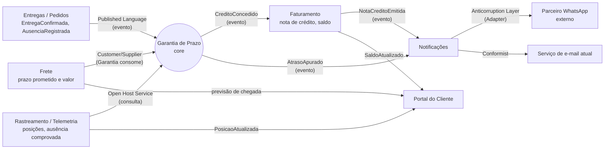

# 1. Modelagem do domínio

## Bounded contexts

| Contexto | Responsabilidade | Requisitos sob sua responsabilidade |
|---|---|---|
| **Garantia de Prazo** (novo, *core domain*) | Apurar o atraso de cada entrega, decidir se há direito a crédito e calcular o valor conforme o tipo de cliente. Garante que cada entrega gera no máximo uma apuração | RF01, RF02, RF03, RF04, RF09, RNF02 |
| **Rastreamento** (serviço de Telemetria da frota) | Receber as posições dos veículos, manter o histórico recente e dizer se uma ausência do destinatário foi comprovada | RF05, RNF01 (parte da telemetria) |
| **Entregas** (serviço de Pedidos, Java) | Registrar a confirmação de entrega (ou a ausência do destinatário) e publicá-la sem perda | RNF01 (parte da confirmação de entrega) |
| **Faturamento** (C#) | Emitir a nota de crédito com número sequencial e único e manter o saldo de créditos do cliente | RF06, RNF03 |
| **Notificações** (Node/TypeScript) | Entregar mensagens ao cliente pelo canal preferido, com retentativa e tratamento da falha final | RF07, RF08 |
| **Portal do Cliente** (React + BFF) | Compor a visão de acompanhamento do pedido para o cliente e empurrar as atualizações ao vivo | RF10 |
| **Frete** (Python, contexto de apoio) | Calcular o valor do frete e o prazo prometido de cada pedido. Não recebe requisito novo: é fornecedor de dados para a Garantia | — |
| **Plataforma** (infraestrutura, não é contexto de negócio) | Empacotamento em contêineres e subida com um comando | RNF04 |

Observações sobre as fronteiras:

- O **tipo de cliente** (Varejo, Corporativo, Cortesia) é cadastrado em Pedidos, mas a
  *regra* de crédito por tipo pertence à Garantia de Prazo. Pedidos só informa o tipo.
- A **comprovação da ausência** (200 m, 10 min) é uma regra geoespacial sobre o histórico
  de posições, por isso fica no Rastreamento. A Garantia não conhece coordenadas: ela pergunta
  "a ausência desta entrega foi comprovada?" e recebe sim ou não.
- O **número da nota de crédito** é assunto fiscal e fica no Faturamento. A Garantia só
  pede a emissão e recebe o número de volta por evento.
- O Cliente **Cortesia** é notificado do atraso (RF03): a Garantia decide *que* precisa
  notificar; Notificações decide *como* entregar (RF07 e RF08).

## Mapa de contexto

Direção: a seta vai de quem **fornece** para quem **consome**. A Garantia é *downstream*
de Frete, Entregas e Rastreamento e *upstream* de Faturamento e Notificações. O parceiro
de WhatsApp tem modelo próprio e fica atrás de uma camada anticorrupção, para que o
formato dele não vaze para dentro de Notificações.

## Entidades e agregados

| Agregado | Raiz | Entidades e objetos de valor | Regra que protege |
|---|---|---|---|
| **Garantia de Prazo** (contexto Garantia) | `ApuracaoDeGarantia` (identidade = `entregaId`) | VO `Atraso` (duração, nunca negativa); VO `Dinheiro` (centavos, BRL); VO `TipoCliente`; VO `PrazoPrometido`; VO `ConfirmacaoDeEntrega` (id da mensagem, data e hora); VO `Credito` (valor, faixa aplicada, teto aplicado) | Uma entrega tem **no máximo uma** apuração (RF09); o crédito nunca passa do teto do tipo de cliente (RF02, RF03); não há crédito se a ausência foi comprovada (RF05) |
| **Política de Crédito** (contexto Garantia) | `PoliticaDeCredito` (uma por tipo de cliente) | VO `FaixaDeAtraso` (limite inferior exclusivo, limite superior inclusivo, percentual); VO `Teto` | As faixas cobrem todo atraso positivo sem lacuna nem sobreposição; um tipo novo é uma política nova, sem alterar as existentes (RF04) |
| **Histórico de Posições do Veículo** (contexto Rastreamento) | `Veiculo` | VO `Posicao` (lat, lon, instante); VO `Parada` (início, fim, coordenada) | Ausência comprovada só com parada contínua de ≥ 10 min a ≤ 200 m do endereço, antes do registro da ausência (RF05) |
| **Nota de Crédito** (contexto Faturamento) | `NotaDeCredito` | VO `NumeroNota` (sequencial); VO `Dinheiro`; referência `apuracaoId` | Número único e crescente, nunca reutilizado (RF06, RNF03); uma nota por apuração |
| **Carteira de Créditos** (contexto Faturamento) | `CarteiraDoCliente` | Lançamentos (nota, valor, data) | Saldo = soma dos lançamentos; só muda por nota emitida |
| **Envio de Notificação** (contexto Notificações) | `Envio` | VO `Canal` (EMAIL, WHATSAPP); VO `Tentativa` (número, resultado, instante); estado (PENDENTE, ENVIADO, FALHOU_DEFINITIVO) | No máximo 3 retentativas; esgotadas, o envio vai para FALHOU_DEFINITIVO e é publicado na fila de falhas, nunca descartado (RF08) |

## Linguagem ubíqua

| Termo | Definição |
|---|---|
| **Prazo prometido** | Data e hora limite de entrega informadas pelo serviço de Frete no momento da contratação |
| **Confirmação de entrega** | Registro, feito pelo motorista no app, de que o pedido foi entregue. Tem um identificador único de mensagem, usado para detectar duplicatas |
| **Atraso** | `confirmação de entrega − prazo prometido`, em horas (com precisão de segundos). Se a entrega for antecipada ou no horário, o atraso é zero |
| **Tolerância** | Atraso de até 2 h (inclusive) que não gera crédito |
| **Faixa de atraso** | Intervalo `(limite inferior, limite superior]` ao qual se associa um percentual do frete. Varejo: (2 h, 24 h] → 10%; (24 h, 72 h] → 25%; acima de 72 h → 50% |
| **Crédito** | Valor devolvido ao cliente: `percentual da faixa × valor do frete`, arredondado ao centavo e limitado ao teto |
| **Teto** | Valor máximo de crédito por pedido: R$ 500 (Varejo), R$ 2.000 (Corporativo) |
| **Tipo de cliente** | Classificação comercial que define a política de crédito: Varejo, Corporativo, Cortesia (e futuros) |
| **Cortesia** | Cliente com frete zero. Não recebe crédito, mas é notificado do atraso |
| **Ausência comprovada** | O veículo ficou parado a até 200 m do endereço por pelo menos 10 min antes do registro da ausência do destinatário. Anula o direito ao crédito |
| **Apuração** | Resultado da análise de uma entrega: atraso, faixa, crédito (ou motivo de não haver crédito) e se o cliente deve ser notificado |
| **Nota de crédito** | Documento fiscal emitido pelo Faturamento para cada crédito concedido, com número sequencial único |
| **Saldo de créditos** | Soma das notas de crédito do cliente ainda não utilizadas |
| **Canal preferido** | Meio de contato escolhido pelo cliente: e-mail ou WhatsApp |
| **Falha definitiva** | Envio de notificação que falhou na tentativa original e nas 3 retentativas; vai para a fila de falhas e gera alerta |
