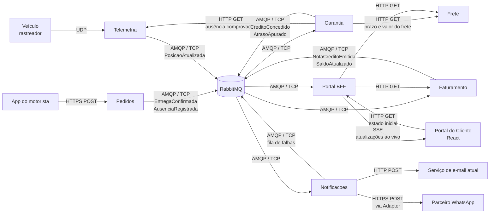

# 2. Arquitetura

## Diagrama dos serviços



## Protocolo de cada comunicação

| Origem | Destino | Protocolo | Requisito atendido | Justificativa |
|---|---|---|---|---|
| Rastreador do veículo | Telemetria | **UDP** | RNF01 | Posição a cada 30 s, com tolerância a perda: o pacote seguinte substitui o perdido. UDP não tem handshake nem retransmissão, o que reduz custo de rede móvel e latência. Reenviar uma posição velha não tem valor |
| App do motorista | Pedidos | **HTTPS (TCP)** POST `/entregas/{id}/confirmacao` | RNF01, RF09 | A confirmação não tolera perda: o app só considera enviada quando recebe `201/200`; senão reenvia com o mesmo `Idempotency-Key`. TCP garante entrega ordenada e confirmada |
| Pedidos | Garantia (via RabbitMQ) | **AMQP sobre TCP**, fila durável, mensagem persistente, *publisher confirms* e *ack* manual | RNF01, RNF02, RF09 | Desacopla Pedidos da Garantia: se a Garantia estiver fora, a mensagem espera na fila e não se perde. O consumo é rápido (segundos), dentro dos 5 min do RNF02. Entrega "pelo menos uma vez" exige consumidor idempotente (ver RF09) |
| Garantia | Frete | **HTTP GET** `/fretes/{pedidoId}` | RF01, RF02 | Consulta síncrona de dado de referência (prazo prometido e valor). Precisa da resposta para calcular; se falhar, a mensagem volta para a fila e é reprocessada |
| Garantia | Telemetria | **HTTP GET** `/entregas/{id}/ausencia-comprovada` | RF05 | Pergunta pontual com resposta sim/não. A regra de 200 m / 10 min fica na Telemetria, que tem o histórico de posições |
| Garantia | Faturamento (via RabbitMQ) | **AMQP sobre TCP** `CreditoConcedido` | RF06, RNF02 | A emissão da nota não pode se perder e não precisa travar a Garantia. A fila absorve picos (ex.: 1.000 entregas atrasadas ao mesmo tempo) |
| Garantia | Notificações (via RabbitMQ) | **AMQP sobre TCP** `AtrasoApurado` | RF03, RF07 | Cliente Cortesia (ou qualquer atraso sem crédito) também é avisado. Assíncrono: a notificação não bloqueia a apuração |
| Faturamento | Notificações e Portal (via RabbitMQ) | **AMQP sobre TCP** `NotaCreditoEmitida`, `SaldoAtualizado` | RF07, RF10 | Avisa o cliente do crédito e atualiza o saldo exibido no Portal |
| Notificações | Serviço de e-mail atual | **HTTP POST** | RF07 | API existente, mantida sem mudanças |
| Notificações | Parceiro WhatsApp | **HTTPS POST** (formato do parceiro) | RF07 | API externa com contrato diferente, acessada só pelo Adapter |
| Notificações | RabbitMQ (fila de falhas) | **AMQP sobre TCP** `NotificacaoFalhou` (DLQ) | RF08 | A falha final é persistida numa fila de falhas e gera alerta para o atendimento; não é descartada |
| Telemetria | Portal BFF (via RabbitMQ) | **AMQP sobre TCP** `PosicaoAtualizada` | RF10 | O BFF recebe as posições sem ter que consultar a Telemetria a cada 30 s |
| Navegador | Portal BFF | **HTTP GET** `/pedidos/{id}/acompanhamento` | RF10 | Carga inicial da tela (estado completo) |
| Portal BFF | Navegador | **SSE** (`text/event-stream`) `/pedidos/{id}/eventos` | RF10 | O fluxo é só do servidor para o cliente (posição, previsão, saldo). SSE usa HTTP comum, reconecta sozinho (`Last-Event-ID`) e passa por proxies. WebSocket seria bidirecional sem necessidade; *polling* desperdiçaria requisições e atrasaria a atualização |

## Padrões de projeto

| Ponto da solução | Padrão | Requisito | Justificativa |
|---|---|---|---|
| Cálculo do crédito por tipo de cliente | **Strategy** (`PoliticaDeCredito`, uma implementação por tipo: `PoliticaVarejo`, `PoliticaCorporativo`, `PoliticaCortesia`) | RF02, RF03, RF04 | Cada tipo tem faixas, percentuais e teto próprios. Com Strategy, um tipo novo é uma classe nova; as existentes não são tocadas (aberto/fechado). Elimina o `if/switch` por tipo, que teria de ser editado a cada tipo novo |
| Escolha da política pelo tipo | **Registry** (fábrica com registro: `RegistroDePoliticas.registrar(tipo, politica)`) | RF04 | O tipo novo do próximo trimestre é registrado na configuração de inicialização, sem editar a fábrica nem as políticas existentes |
| Integração com o parceiro de WhatsApp | **Adapter** (`WhatsAppAdapter` implementa a interface `CanalDeNotificacao` e traduz para o formato do parceiro) | RF07 | A API do parceiro tem formato diferente do serviço atual. O Adapter isola essa diferença: o resto de Notificações só conhece `CanalDeNotificacao.enviar(mensagem)`. Também funciona como camada anticorrupção |
| Seleção do canal preferido | **Strategy** sobre `CanalDeNotificacao` (`CanalEmail`, `WhatsAppAdapter`) | RF07 | O canal é escolhido em tempo de execução pela preferência do cliente |
| Retentativa de envio | **Decorator** (`CanalComRetentativa` envolve qualquer `CanalDeNotificacao`) + **Dead Letter Queue** | RF08 | A política de 3 retentativas fica num único lugar e vale para todos os canais, sem duplicar código em cada um. Esgotadas as retentativas, publica `NotificacaoFalhou` na DLQ e gera alerta |
| Consumo de `EntregaConfirmada` | **Idempotent Consumer** (tabela *inbox* + restrição de unicidade) | RF09 | Ver seção RF09 abaixo |
| Publicação dos eventos da Garantia | **Transactional Outbox** | RNF01, RNF02 | A apuração e o evento `CreditoConcedido` são gravados na mesma transação; um *relay* publica a outbox no RabbitMQ. Evita "apurou mas não avisou o Faturamento" se o serviço cair entre gravar e publicar |
| Comunicação entre contextos | **Publish/Subscribe** (Observer distribuído via RabbitMQ) | RNF01, RNF02 | Pedidos não precisa saber quem reage à entrega (Garantia hoje, outros amanhã) |

### Ponto onde a dupla decidiu não aplicar padrão

1. **Faixas de atraso dentro de uma política: sem Chain of Responsibility.** Parecia
   cabível encadear um *handler* por faixa (tolerância → 10% → 25% → 50%). Decidimos não
   usar: as faixas são **dados**, não comportamento. Uma lista ordenada de
   `FaixaDeAtraso(limite_superior, percentual)` percorrida num laço simples é mais legível,
   mais fácil de testar nos valores-limite e permite à política Corporativa reaproveitar as
   faixas do Varejo com o percentual dobrado. Uma cadeia de objetos adicionaria classes sem
   ganho de extensibilidade, pois o que muda entre tipos já está coberto pelo Strategy.
2. **Gerador de número da nota: sem Singleton.** Um contador em memória "único" não é único
   quando o Faturamento roda com mais de uma réplica, e se perde ao reiniciar. A unicidade
   do RNF03 tem de vir do banco de dados (ver abaixo), não de um objeto em memória.

## Confirmação de entrega duplicada (RF09)

A mensagem pode chegar duas vezes por dois motivos: o app reenviou a confirmação (timeout
no HTTP) ou o RabbitMQ reentregou porque o *ack* não chegou ("pelo menos uma vez"). A
garantia fica em **duas camadas**:

1. **Pedidos (borda):** o app envia `Idempotency-Key` (UUID gerado no aparelho). Pedidos
   guarda a chave com restrição `UNIQUE`; uma segunda requisição com a mesma chave devolve a
   resposta original e **não publica outro evento**.
2. **Garantia (consumidor, garantia principal):** cada `EntregaConfirmada` traz `entregaId`
   e `mensagemId`. Na mesma transação do banco da Garantia:
   ```sql
   INSERT INTO inbox (mensagem_id) VALUES (:mensagemId);           -- PK
   INSERT INTO apuracao (entrega_id, ...) VALUES (:entregaId, ...); -- UNIQUE(entrega_id)
   INSERT INTO outbox (tipo, payload) VALUES ('CreditoConcedido', ...);
   COMMIT;
   ```
   Se qualquer `INSERT` violar a unicidade, a transação é desfeita, a mensagem recebe *ack*
   e é descartada como duplicata. A restrição `UNIQUE(entrega_id)` na tabela `apuracao`
   cobre até o caso de duas mensagens **diferentes** para a mesma entrega. Como a decisão é
   do banco, funciona com várias réplicas da Garantia consumindo em paralelo.
3. **Faturamento (defesa extra):** `UNIQUE(apuracao_id)` na tabela de notas, para que uma
   reentrega de `CreditoConcedido` não gere segunda nota.

## Numeração das notas de crédito (RF06 e RNF03)

- O número vem de uma **`SEQUENCE` do PostgreSQL** do Faturamento
  (`CREATE SEQUENCE nota_credito_seq START 1 INCREMENT 1 NO CYCLE;`), lida com `nextval()`
  no mesmo `INSERT` da nota. `nextval` é atômico mesmo com milhares de transações
  concorrentes e entre réplicas, porque quem serializa é o banco.
- A coluna `numero` tem restrição `UNIQUE` como segunda proteção.
- `NO CYCLE` impede que a sequência recomece e repita números.
- Observação: uma transação desfeita "queima" o número obtido, então pode haver lacunas.
  O RF06 exige sequencial e **nunca repetido**; se a área fiscal exigir sem lacunas, a
  alternativa é uma tabela `contador` com `UPDATE ... SET valor = valor + 1 RETURNING valor`
  dentro da transação da nota (bloqueio de linha), trocando vazão por ausência de lacunas.
- Verificação: CT24 do plano de testes dispara 1.000 emissões concorrentes contra um
  PostgreSQL real e confere 1.000 números distintos.

## Execução em contêineres (RNF04)

Tudo sobe com `docker compose up -d`.

```yaml
services:
  rabbitmq:
    image: rabbitmq:3.13-management
    ports: ["5672:5672", "15672:15672"]
    healthcheck:
      test: ["CMD", "rabbitmq-diagnostics", "-q", "ping"]

  postgres:
    image: postgres:16
    environment:
      POSTGRES_PASSWORD: logitech
    volumes: ["./infra/init-dbs.sql:/docker-entrypoint-initdb.d/init.sql"]  # cria um banco por serviço
    ports: ["5432:5432"]
    healthcheck:
      test: ["CMD", "pg_isready"]

  telemetria:
    build: ./telemetria
    ports: ["9000:9000/udp", "8081:8080"]
    depends_on: { rabbitmq: { condition: service_healthy }, postgres: { condition: service_healthy } }

  pedidos:            # Java
    build: ./pedidos
    ports: ["8082:8080"]
    depends_on: { rabbitmq: { condition: service_healthy }, postgres: { condition: service_healthy } }

  frete:              # Python
    build: ./frete
    ports: ["8083:8080"]
    depends_on: { postgres: { condition: service_healthy } }

  garantia:           # novo serviço
    build: ./garantia
    ports: ["8084:8080"]
    environment:
      FRETE_URL: http://frete:8080
      TELEMETRIA_URL: http://telemetria:8080
      AMQP_URL: amqp://rabbitmq:5672
    depends_on: { rabbitmq: { condition: service_healthy }, postgres: { condition: service_healthy }, frete: { condition: service_started }, telemetria: { condition: service_started } }

  faturamento:        # C#
    build: ./faturamento
    ports: ["8085:8080"]
    depends_on: { rabbitmq: { condition: service_healthy }, postgres: { condition: service_healthy } }

  notificacoes:       # Node/TypeScript
    build: ./notificacoes
    ports: ["8086:8080"]
    environment:
      WHATSAPP_PARCEIRO_URL: https://api.parceiro-whatsapp.example
    depends_on: { rabbitmq: { condition: service_healthy } }

  portal-bff:
    build: ./portal-bff
    ports: ["8087:8080"]
    depends_on: { rabbitmq: { condition: service_healthy }, frete: { condition: service_started }, faturamento: { condition: service_started } }

  portal:             # React
    build: ./portal
    ports: ["3000:80"]
    depends_on: [portal-bff]
```
